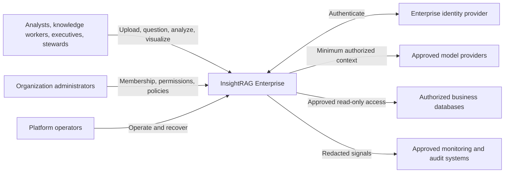
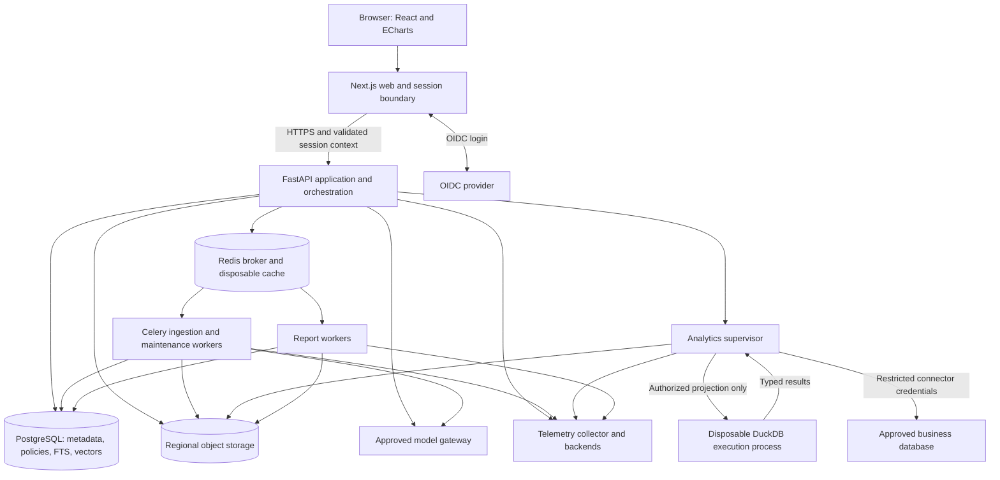
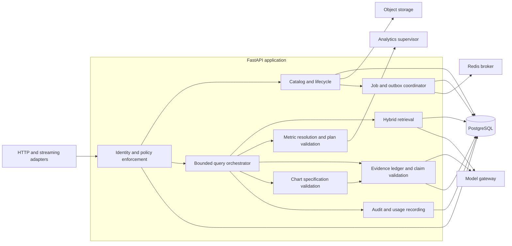

# C4 diagrams

Status: Proposed. Mermaid flowchart notation expresses C4 semantics without depending on experimental C4-specific rendering. A container is an execution/storage boundary; a component is internal to a container. See [C4 sources](sources.md).

## Context

## Containers

Storage and identity services are not public content APIs. The web/API can mediate downloads when immediate revocation is required. Signed uploads go only to quarantine with unique keys and verified immutable completion.

## API application components

The diagram decomposes the API, not the workers. Parsing and DuckDB are intentionally outside this component boundary. Plain module calls are preferred inside the backend; external boundaries use typed, authenticated requests and scoped job identifiers.
