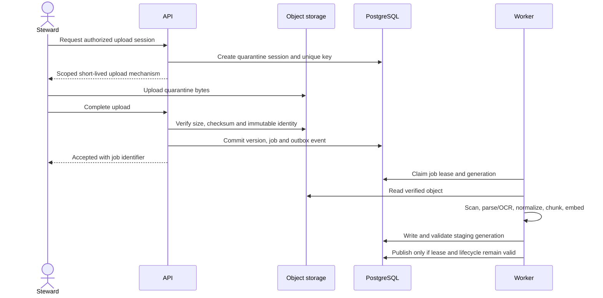

# End-to-end flows

Status: Proposed. Every flow carries trusted organization/principal context, correlation IDs, bounded deadlines, and current policy checks. Examples are synthetic.

## 1. Document ingestion



Type detection checks actual bytes, not browser MIME claims. Reject oversized files, decompression bombs, unsafe macros, unsupported encryption, or empty parse results explicitly. Unique keys prevent routine collisions; bind completion to an object version or copy into immutable processing storage so a reusable upload URL cannot mutate accepted input. Expire abandoned sessions.

Idempotency key: organization + resource version + operation + pipeline profile. Duplicate content within another permission domain does not imply shared access or cross-tenant deduplication. Outbox dispatch can repeat; publication is conditional and unique. Failed parsing never marks content ready.

## 2. Document Q&A

1. Verify session/token, current membership, workspace and resource permissions.
2. Resolve question scope and clarify if material intent is ambiguous.
3. Search active permitted generations with lexical and vector queries.
4. Fuse rankings, rerank authorized candidates and select bounded evidence.
5. Compose structured claims referencing evidence IDs, treating retrieved instructions as data.
6. Check citation IDs/locators; evaluate claim support; abstain or qualify unsupported statements.
7. Recheck permissions, tombstones and source versions before final content release.
8. Persist evidence dependencies and return answer, citations, freshness and limitations.

Stream progress states first. MVP buffers sensitive answer content until the final permission check; raw generated tokens could otherwise disclose content that was revoked mid-run. Reopening a persisted answer performs authorization again. Empty retrieval produces an explicit insufficient-evidence response, not a general-knowledge substitute presented as company fact.

## 3. SQL analytics

1. Resolve authorized catalog objects, metric version, dimensions, filter values, units, timezone and reporting interval.
2. Clarify missing semantics (for example gross versus net sales).
3. Produce a typed plan using only approved fields/operators/joins.
4. Validate authorization, type compatibility, grain, cardinality and query budgets.
5. Compile server-owned expressions and identifiers into SQL with bound values.
6. Execute over a pinned permitted snapshot in an isolated process, or use approved read-only connector credentials.
7. Enforce timeout/memory/CPU/temp-disk/result/scan limits; terminate overruns.
8. Validate typed decimal results and preserve plan, parameters, source versions and execution timestamp.

No raw LLM SQL enters execution. Missing data, mixed currencies, duplicate keys, nulls and denominator zero are explicit conditions. Cross-dataset joins require approved keys/grain; do not infer a join from similar labels. Live connectors must state reproducibility limits or materialize a permitted snapshot.

## 4. Chart and report generation

Validated result -> permitted chart recommendation -> typed chart spec -> spec/unit/series validation -> ECharts and accessible data table. Every series binds existing columns and a result identifier. No invented points, JavaScript callbacks, HTML injection or arbitrary external URLs.

Dashboards store metric plans and source/version policy, not executable prompts. Default panels follow current published versions on refresh; each rendering pins versions. Refresh marks old panels stale, reports partial failures per panel, and limits fan-out. Export jobs reauthorize when queued, executed and downloaded; CSV cells neutralize formula injection, and PDF rendering uses constrained templates.

## 5. Document/dataset updates

Upload new immutable version -> scan/parse/validate -> stage new generation/snapshot -> conditional active-pointer swap -> invalidate dependent cache/materializations -> retain prior versions under policy. Existing in-flight queries may finish against their pinned version if still authorized; label the version. A failed update preserves the previous active version and surfaces the new failure.

Incremental ingestion reuses unchanged content only within the same tenant and compatible permission/profile context. Embedding/model changes create a new generation; never compare vectors from incompatible spaces. Avoid exposing a mixture of old and new chunks.

## 6. Deletion and revocation

```mermaid
sequenceDiagram
    actor Owner
    participant API
    participant DB as PostgreSQL
    participant Worker
    participant Store as Artifact stores
    Owner->>API: Delete authorized resource
    API->>DB: Tombstone, revision, deletion ledger and job
    API-->>Owner: Access blocked; purge pending
    Worker->>DB: Fence active jobs and enumerate dependencies
    Worker->>Store: Purge source and derived live copies
    Worker->>DB: Remove chunks/checkpoints and record receipts
    Worker->>DB: Track holds and backup expiry separately
```

Readers check committed tombstones. Workers recheck generation/fencing token before publication. Dependency traversal invalidates historical answers, analytical results, charts, exports and caches. Permission revocation changes authorization revision even without deletion. Legal hold may prevent destruction but does not restore user access. Restore replays the latest deletion ledger before serving; absent reconciliation, stay closed. Previously downloaded files are outside platform revocation control.

Deletion states: requested/access_blocked -> purging -> live_purged -> backup_expired -> complete; `held` is explicit and cannot be reported as fully purged. Audit receipts contain minimal references rather than deleted source text.
