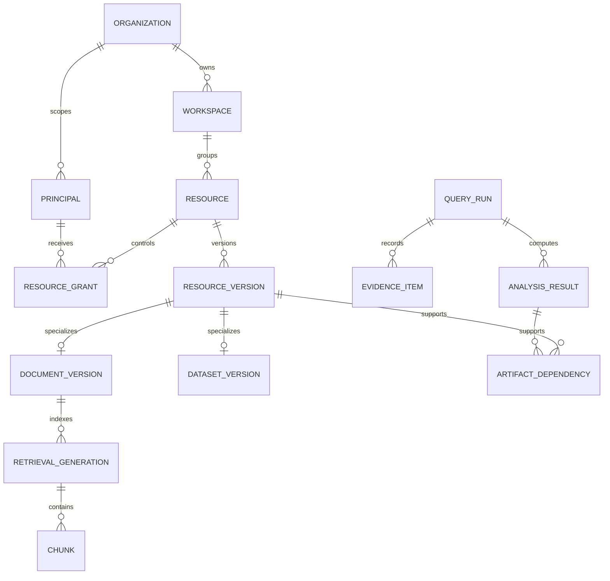

# Multi-tenant logical schema

Status: Proposed logical design, not executable DDL. SQLAlchemy mappings and Alembic migrations belong to later phases. UUID identifiers, typed columns, explicit constraints, and database-enforced tenancy are the baseline.

## Ownership and keys

`organization_id` is required on tenant-owned rows, including descendants and join tables. Tenant-owned references use `(organization_id, id)` unique keys and composite foreign keys. Workspace-scoped child references also enforce workspace compatibility where applicable. A global UUID does not replace these constraints.

Global identity stores only account identity. Tenant memberships and grants are separately scoped. `identities(issuer, subject)` is unique; email is mutable and not an authorization key. `organization_id` on the organizations table itself is its `id`; organization access policies check membership rather than a nonexistent parent tenant.

## Proposed entities

| Entity | Important fields and relationships |
| --- | --- |
| organizations | id, name, home_region, home_cell, reporting_timezone, default_policy_id, state |
| workspaces | organization_id, id, name, state |
| users / identities | global user id; issuer, subject, user_id; minimal profile |
| organization_memberships | organization_id, user_id, role, status, revision |
| workspace_memberships | organization_id, workspace_id, principal_id, role, status |
| principals | organization_id, id, kind=user/group/service, referenced identity; one organization-local policy subject |
| groups / group_memberships | organization_id, group principal id, member principal id; prevent cycles/nested groups initially |
| resource_grants | organization_id, resource_id, principal_id, capability; unique resource/principal/capability |
| authorization_revisions | organization_id, principal/scope id, monotonic revision; invalidates cached access |
| resources | organization_id, id, workspace_id, kind, lifecycle_state, active_version_id, retention_policy_id, deleted_at |
| resource_versions | organization_id, resource_id, id, sequence, checksum, state, created_by, created_at |
| document_versions | organization_id, version_id, immutable object key/version, media_type, parser_profile, language |
| retrieval_generations | organization_id, document_version_id, id, chunker_profile, embedding_profile, state, expected_count |
| chunks | organization_id, generation_id, id, ordinal, source_locator JSON, text, search_vector |
| chunk_embeddings | organization_id, chunk_id, embedding_profile_id, vector; compatible dimensions per physical collection |
| dataset_versions | organization_id, version_id, canonical snapshot key/version, schema_hash, row_count, validation_report |
| dataset_columns | organization_id, dataset_version_id, column_id, name, logical_type, nullability, unit, classification |
| dataset_relationships | organization_id, left/right dataset, approved keys, cardinality, grain rules |
| metric_definitions / metric_versions | organization_id, metric id, owner; immutable expression, grain, unit, allowed dimensions, date/currency/null policy |
| connections | organization_id, resource_id, type, credential_reference, allowed network policy, state |
| catalog_objects / connector_snapshots | organization_id, connection, approved database objects/columns; snapshot/freshness identity |
| upload_sessions | organization_id, resource_id, id, quarantine key, expected/actual checksum and size, expiry, completion state |
| jobs | organization_id, id, resource_version_id, operation_key, kind, state, attempt, lease_until, fencing_generation |
| outbox_events | organization_id, id, job_id, event_type, delivery_state, created_at |
| conversations / messages | organization_id, workspace_id, owner principal, private sharing policy; role/content and dependencies |
| query_runs | organization_id, id, conversation_id, initiating principal, policy_revision, provider_profile, budgets, state |
| evidence_items / answer_claims / claim_evidence_links | organization_id, run_id, source version and locator or analytical result; typed claims and supporting links |
| analysis_plans / analysis_results | organization_id, run_id, typed plan/hash, metric versions, source versions, result schema/object, timestamps |
| dashboards / dashboard_panels / chart_specs | organization_id, owner, workspace; typed plans/result policy; constrained presentation config |
| exports / artifact_dependencies | organization_id, artifact id, status/object; dependency edges to source/metric/result/version |
| audit_events / usage_records | organization_id, event id, actor, operation, target reference, timestamp, outcome; redacted usage/cost |
| retention_policies / legal_holds | organization_id, versioned policy; resource/policy hold scope, authority, review date |
| deletion_jobs / deletion_ledger | organization_id, resource reference, scope, live/backup/hold state, receipts; monotonic tombstones |

`resource_versions` is the common parent for documents and datasets. An active-version composite foreign key references `(organization_id, resource_id, version_id)`, preventing a resource from activating another resource's version. Separate document/dataset subtype rows avoid a polymorphic foreign key that cannot be enforced. Resource kind/subtype consistency needs constraints and migration tests.

The artifact dependency table uses a common artifact/resource registry so edges have real referential integrity; do not implement unvalidated arbitrary type/id pairs. Evidence can reference retained source versions without embedding source text into permanent audit logs.

## Relationship view

## Constraints and state transitions

- Unique version sequence per tenant/resource; unique chunk ordinal per generation.
- Stable operation key unique per organization; payload hash must match on replay or return conflict.
- Published generations require validated completeness and compatible embedding profile.
- `active_version_id` changes only after validation under a transaction and lifecycle/fencing check.
- Currency uses explicit decimal precision and currency codes; no float summation of money.
- Instants use timezone-aware timestamps; business dates and source timezones are preserved separately.
- Invalid memberships, missing tenant context, unknown grant principals and missing scope fail closed.
- Tenant content cannot be read through audit/search/export paths that bypass the policy boundary.
- References needed by legal holds block physical purge; state reports the hold explicitly.

Version state: uploaded -> quarantined -> processing -> validated -> published, with failed/cancelled terminal states. Resource state: active -> access_blocked -> purging -> live_purged -> complete, with explicit held/backup-expiry substates. Worker fencing generations increase on replacement, cancellation and deletion.

## Initial indexes and evolution

B-tree: organization/workspace catalogs, memberships/grants, current publications, job leases, outbox delivery, source dependencies and audit timestamps. GIN: text search vector with language/profile awareness. Vector: begin with exact authorized scans for small corpora, then evaluate HNSW against actual tenant/filter distributions. Every query must remain authorized regardless of query-plan choice.

Do not create 10,000 tenant partitions by habit. Benchmark bounded hash partitions/cells and isolate heavy tenants; use dedicated physical collections only where justified. Index sizes, write amplification, maintenance, and RLS query plans require measurement.

## Migration and compatibility policy

Use expand/migrate/contract changes; add nullable/backfilled columns before enforcing new constraints, and retain old API readers during rollout. Separate migration ownership from runtime roles. Check RLS policies and grants after every migration. Rebuild embeddings in a new generation rather than silently changing vector semantics. Backfill jobs are tenant-scoped, resumable and fenced.
