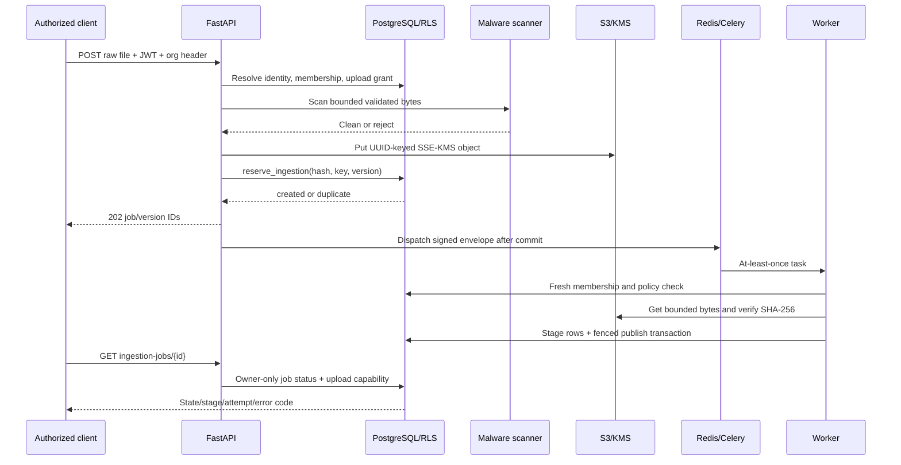
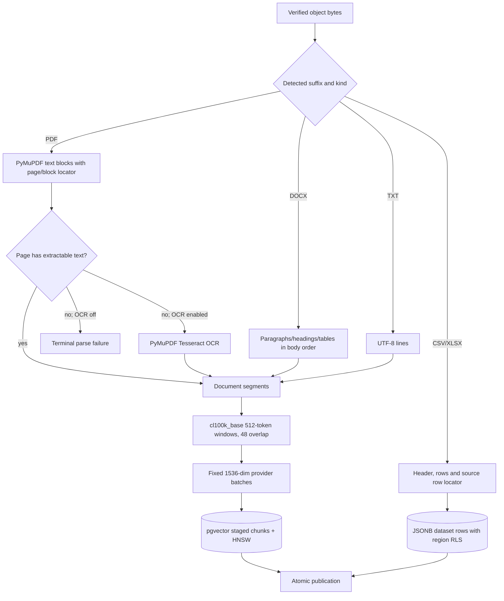
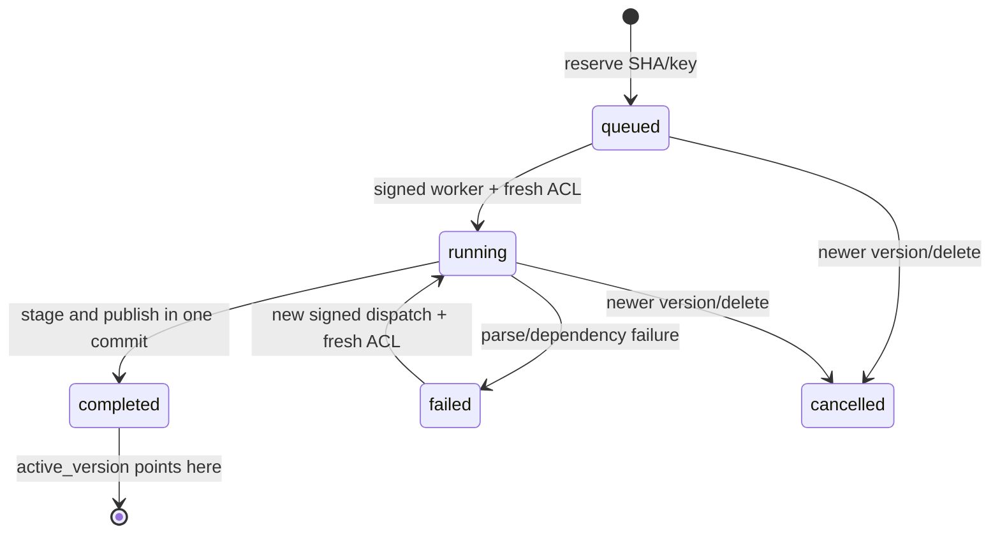

# Ingestion architecture and execution flows

Every diagram here describes the Phase 4 code path. The storage/embedding/scanner endpoints require operator configuration; diagrams do not claim that those services were exercised.

## Upload, progress and worker

Polling is enough for seconds-to-minutes ingestion; no persistent WebSocket server, reconnect tokens or fan-out tier is justified. The client may poll with exponential backoff and stop at a terminal state. A lost queue message leaves a durable `queued` row for operator redispatch. For deletion, the existing delete API tombstones the resource immediately; the signed deletion worker sees `pending_storage`, enumerates version keys under current policy, deletes objects, then removes chunks/rows/versions and finishes the security job. Retention/legal hold can keep the job held.

## Parsing and indexing branches

The `ingestion_chunks` HNSW index accelerates future similarity search but no Phase 5 retrieval endpoint uses it yet. Token windows never combine unrelated page/section segments. The lexical `locator` is copied from the parser; it is not invented after retrieval. For DOCX there is no stable rendered page number, so the locator is body/table position. CSV/XLSX rows are not embedded. Empty pages without OCR and empty datasets fail.

## Version, failure, deletion

`latest_version` fences old jobs; `active_version` points only at successfully published data. Publication checks the job owner, current policy revision, current upload grant, non-deleted resource, latest version, and staged content. A concurrent policy change is serialized through the organization revision lock. On failure inside the staging transaction, inserts roll back. The object and failed version remain for investigation or later cleanup; an abandoned object after a pre-reservation failure requires reconciliation. Deletion blocks access immediately through resource state/RLS while physical erasure is asynchronous and backups follow the retention policy.
