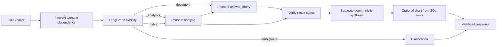

# Phase 7: governed query orchestration

Phase 7 adds one versioned endpoint, `POST /api/v1/orchestration/query`, which routes a question to the existing document RAG service, the governed sales analytics service, or both. Its output keeps document narrative and exact SQL figures in separate typed fields. This is a **bounded Phase 7 implementation**, not a claim that Phase 6's unresolved financial definitions, currency conversion, or dashboard features are complete.

## Objectives and acceptance

An authenticated, currently authorized caller can select document resources, one dataset, or both. A finite LangGraph path classifies, invokes the trusted service(s), checks output shape, synthesizes separated evidence, and optionally builds a chart specification from SQL rows. Ambiguous source selection requests clarification. Authorization failures propagate. A provider outage in a hybrid request can return only verified analytics, marked partial. See [test evidence](../../testing/orchestration-tests.md).



## Why LangGraph here

[LangGraph StateGraph](https://reference.langchain.com/python/langgraph/graph/state/StateGraph) makes branches and termination explicit and can expose node-level execution. A plain async function would be simpler for this small graph; the selected dependency is justified by the requested Phase 7 learning goal and possible later human review points, not by a measured performance advantage. No open-ended agent loop, raw model-generated tool arguments, or new SQL compiler was added. Classification uses a deterministic rule and Pydantic [RouteDecision](../../../apps/api/src/insightrag/orchestration/contracts.py). It cannot grant resource access.

## Actual code and request flow

- [contracts.py](../../../apps/api/src/insightrag/orchestration/contracts.py) validates request scope and the route, chart, and response schemas. `workspace_id`, resource IDs and dataset ID are selections, never authorization credentials.
- [graph.py](../../../apps/api/src/insightrag/orchestration/graph.py) builds `StateGraph`, has `classify`, `document`, `analytics`, `verify`, `synthesize`, and `clarify` nodes, and runs it with an eight-step recursion ceiling and request timeout. Nodes replace state keys; there are no reducers or parallel merges because hybrid work is sequential.
- [routes.py](../../../apps/api/src/insightrag/orchestration/routes.py) obtains the existing server-derived identity, calls Phase 5's [query route](../../../apps/api/src/insightrag/retrieval/routes.py) and Phase 6's [analyze](../../../apps/api/src/insightrag/analytics/service.py), and passes `expected_workspace_id` into analytics. Those services continue to enforce current resource grants, row security, version checks and evidence revalidation.
- [config.py](../../../apps/api/src/insightrag/core/config.py) bounds `INSIGHTRAG_ORCHESTRATION_TIMEOUT_SECONDS` to 1–120 seconds (default 20). Optional per-request `max_context_tokens` and `max_completion_tokens` can only lower Phase 5's configured caps. They do not cover prompt-template overhead or provide a dollar-denominated provider-cost admission budget.
- [main.py](../../../apps/api/src/insightrag/main.py) registers the new API router. Existing RAG and analytics endpoints remain backward compatible.

The graph is compiled per request without a checkpointer. Graph state can contain private evidence, so storing it in process memory, Redis, or a shared checkpoint database without a tenant-scoped retention and revocation design would be unsafe. Phase 5's conversation store remains the approved conversation mechanism; every follow-up goes through its current authorization checks. No graph resume endpoint is exposed. A cancelled request is retried by the client as a new authenticated request; the graph itself does not replay side-effecting RAG writes.

## Request example

```json
{
  "workspace_id": "00000000-0000-0000-0000-000000000001",
  "question": "Compare 2025 sales with the report's explanation",
  "document_resource_ids": ["00000000-0000-0000-0000-000000000002"],
  "dataset_id": "00000000-0000-0000-0000-000000000003",
  "document_question": "Summarize the report's explanation of shipment delays",
  "analytics_question": "Revenue by region in 2025",
  "year": 2025,
  "chart": true
}
```

The UUIDs above illustrate the contract, not deployed resources. Send the normal bearer token and `X-Organization-ID` header. For a hybrid request, the two explicit subquestions prevent the graph from silently rewriting financial terms. The response contains `document` with Phase 5 citations, `analytics` with exact decimal strings and provenance, and a chart spec copied from `analytics.rows`. It does **not** claim the document explains causation of the measured metric.

## Five executed synthetic traces

The parameterized [graph test](../../../apps/api/tests/test_orchestration.py) executed all five with synthetic trusted-tool outputs. The `100.1000 INR` value and shipment sentence are fixture values, not production observations.

| Input | Route / node sequence | Validated output |
|---|---|---|
| “Summarize the report” + one document | document → `classify, document, verify, synthesize` | Phase 5 answer and source citation |
| “Revenue by region in 2025” + one dataset | analytics → `classify, analytics, verify, synthesize` | Delhi `100.1000` INR from the synthetic analytics tool |
| Combined question + separate document/analytics subquestions | hybrid → `classify, analytics, document, verify, synthesize` | Two separated sections; exact SQL value and cited narrative |
| Revenue chart question + dataset | analytics → `classify, analytics, verify, synthesize, chart` | Bar spec with categories `Delhi`, value `100.1000`, metric and version |
| Numerical question without a governed dataset | clarification → `classify, clarify` | No tool call or private data |

The test also verifies a timed-out graph, an authorization failure that propagates, and a hybrid document-provider outage that returns only verified analytics as `partial`. These are actual unit-level traces; production provider, load, and end-to-end route timing are not measured here.

## Run and verify

From repository root with the locked environment, start the existing Phase 3 PostgreSQL/Redis services and apply the current migration if needed. Then run:

```powershell
.venv/Scripts/pytest.exe -q apps/api/tests/test_orchestration.py
.venv/Scripts/pytest.exe -q apps/api/tests -m "not integration"
.venv/Scripts/ruff.exe check apps/api/src apps/api/tests
.venv/Scripts/mypy.exe apps/api/src
npm run check:docs
```

Real-service tests require the isolated synthetic `INSIGHTRAG_TEST_*` URL files described in [the analytics test guide](../../testing/analytics-tests.md). Use its test-only command; fixtures create and remove tenants. The endpoint requires the same OIDC/provider setup as the underlying services. No fabricated integration credentials are supplied.

## Production, failure and next dependencies

The total timeout, LangGraph recursion ceiling, Pydantic contracts, existing request rate limiter, Phase 5 token settings, SQL statement timeout and row limit bound major work. OTel API spans and structured completion logs record route, status, node list, elapsed time and token counts, without raw questions or document text. A configured OTel SDK/exporter is needed to export spans; this phase does not provision one. Analytics failure stops hybrid output; only document provider unavailability after successful analytics can yield a partial result. No graph checkpoint or automatic retry is enabled because private state and conversation writes need an approved durable-recovery policy.

The largest open gaps are owner-approved financial metrics/FX and join semantics from [the Phase 6 review](../analytics/PHASE_06_REVIEW_REPORT.md), complete hybrid natural-language decomposition, dollar-denominated provider cost admission, chart/dashboard rendering, and representative concurrent-load tests. These are not silently supplied by LangGraph. See [architecture](architecture.md), [walkthrough](implementation-walkthrough.md), [comparisons](technology-comparisons.md), [security](../../security/orchestration-security.md), [concepts](../../concepts/langgraph-fundamentals.md), and [interview preparation](../../interview/phase-07-langgraph.md).
