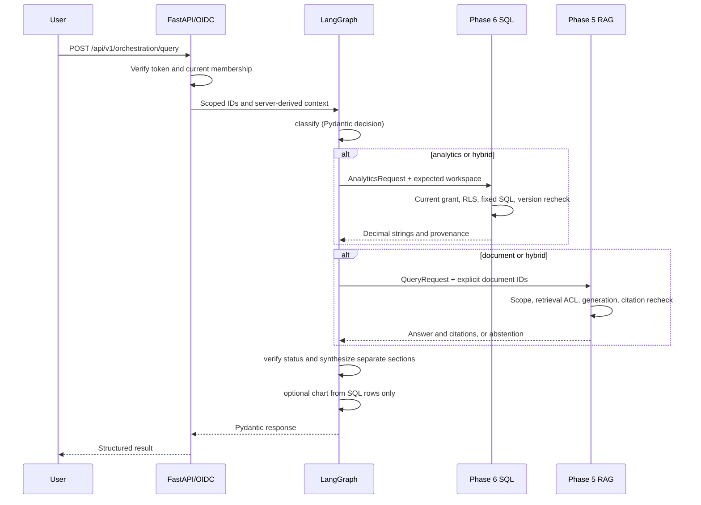

# Phase 7 architecture and transitions

The graph uses a `TypedDict` [GraphState](../../../apps/api/src/insightrag/orchestration/graph.py), Pydantic [RouteDecision](../../../apps/api/src/insightrag/orchestration/contracts.py), and no reducer. Every node returns a partial state update. The branches are finite: `START → classify → (clarify | document | analytics → optional document) → verify → synthesize → optional chart → END`. `recursion_limit=8` catches an accidental future cycle. There is no LLM router. A natural-language question with both a dataset and documents requires explicit, separately validated subquestions; otherwise `clarify` terminates.

The graph never interprets a valid JWT or caller-supplied organization header as a document or dataset grant. [Context dependency](../../../apps/api/src/insightrag/security/dependencies.py) resolves current membership; each service independently enforces resource and row permissions. The analytics workspace check occurs in the **same transaction** as resource authorization in [analyze](../../../apps/api/src/insightrag/analytics/service.py). The sequential hybrid order lets verified SQL survive a document-provider outage, while an authorization denial still aborts. Parallel branches would need safe state reducers, consistent policy snapshots, and extra database/provider pressure; there is no measured reason to add them now.

No checkpoint is configured. A reusable checkpoint thread could retain private RAG snippets after revocation, so durable resume needs a tenant-scoped encrypted store, retention/deletion propagation, identity-bound thread IDs and permission revalidation before release. The Phase 5 conversation ID is passed through to Phase 5 and remains owned by that service. Graph state is ephemeral and requests are independent.
