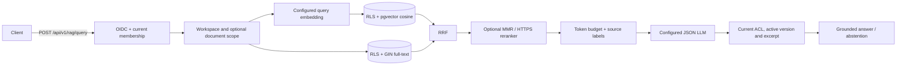

# Phase 5 engineering guide — retrieval and grounded generation

This guide describes the **implemented** document-question path. Read [Phase 5 scope](../../phase-05.md), [architecture](architecture.md), [walkthrough](implementation-walkthrough.md), [configuration](configuration-guide.md), [comparisons](technology-comparisons.md), [security](../../security/retrieval-security.md), [evaluation](../../testing/retrieval-evaluation.md), and [interview preparation](../../interview/phase-05-retrieval-and-generation.md). Uploading indexes evidence; it does not train or fine-tune the model.

## Objectives, acceptance and technology

The product needs answers from currently authorized, published document versions with traceable locators. Phase 3 supplies OIDC identity, membership, grants, transaction-local tenant context and RLS. Phase 4 supplies 1,536-dimensional pgvector chunks with version metadata. Phase 5 adds a PostgreSQL GIN full-text index, two candidate searches, RRF, optional MMR and HTTPS reranking, a token-bounded context, a JSON chat adapter, citation validation, and RLS-protected conversation turns. The selected stack avoids a second search service and keeps permission logic in the established database boundary. `ts_rank_cd` is PostgreSQL cover-density ranking, not BM25. The new code does not provide a local cross-encoder, streaming, or numerical analytics.

The route is `POST /api/v1/rag/query` with bearer token and `X-Organization-ID`. Example request: `{"workspace_id":"<UUID>","question":"Who approves invoice INV-42?","resource_ids":[]}`. `resource_ids=[]` means currently readable documents in that workspace, never all tenants. A response has `answer`, `status`, `uncertainty`, `conversation_id`, token usage if supplied by the provider, and citations with document/workspace IDs, version, title, position, locator, excerpt and stable label. `conversation_id` continues a conversation; the server checks the owner and workspace. A numerical aggregate question receives `analytics_required`; Phase 6 must provide the deterministic answer path.

## Files and boundaries

| File | Role |
| --- | --- |
| `apps/api/migrations/versions/0006_retrieval.py` | GIN FTS index; RLS conversation and turn tables; phase readiness marker. |
| `apps/api/src/insightrag/retrieval/routes.py` | Authenticated FastAPI route, configured adapter construction. |
| `contracts.py`, `query.py` | Pydantic API limits; conservative NFC/whitespace normalization and analytics handoff. |
| `repository.py` | SQL-side active-version, model, workspace, tenant and ACL predicates; post-inference exact evidence reread. |
| `ranking.py`, `rerank.py` | RRF, cosine/MMR; optional HTTPS score adapter with fallback. |
| `context.py` | Token budget, deduplication, opaque source labels, excerpt check. |
| `provider.py` | OpenAI-compatible JSON chat adapter with timeout, TLS and output validation. |
| `service.py` | Retrieval lifecycle, authorization fences, conversation persistence, audit and stage orchestration. |
| `evaluation.py`, `scripts/evaluate-retrieval.py` | Deterministic metrics and tiny synthetic rank-fusion demonstration. |

The `service.py` flow opens a scoped DB transaction to check workspace/conversation, releases it for embedding, opens a new scoped transaction for candidate search, releases it for inference, then opens a final transaction for source/policy revalidation and persistence. It persists the question, outcome and opaque source/version references, not the generated answer or document excerpts. This limits pool occupancy during remote I/O and retained source content. Policy changes or deletion during inference produce a retryable 409 rather than releasing stale citations. A remaining race between final commit and HTTP delivery requires system-wide revocation semantics and/or short-lived evidence leases; this implementation does not claim instantaneous global revocation after the final check.

## Local run and verification

From repository root, configure the existing Phase 3/4 identity, database, Redis, storage and embedding profile, plus `INSIGHTRAG_GENERATION_ENDPOINT`, `INSIGHTRAG_GENERATION_API_KEY_FILE`, and `INSIGHTRAG_GENERATION_MODEL`. The active document version's `model_id` must match `INSIGHTRAG_EMBEDDING_MODEL`. Keep secrets in secret files or a managed store. Run `uv sync --locked`, `uv run alembic -c apps/api/alembic.ini upgrade head`, and `uv run uvicorn insightrag.main:app --app-dir apps/api/src --reload`. A document question returns 503 if required providers are unconfigured; an authorized exact-analytics question can still return `analytics_required`. Neither path fabricates an answer. Existing Docker Compose may host local PostgreSQL/Redis, but a real OIDC issuer and approved HTTPS model endpoints remain necessary for an end-to-end HTTP answer.

Checks: `uv run --locked --no-sync ruff check .`; `uv run --locked --no-sync ruff format --check .`; `uv run --locked --no-sync mypy apps/api/src`; `uv run --locked --no-sync pytest -q apps/api/tests -m 'not integration'`; real-service configuration and commands are in [evaluation](../../testing/retrieval-evaluation.md). `uv run --locked --no-sync python scripts/evaluate-retrieval.py` measures only local fusion on a four-case labelled toy ranking, never retrieval-provider latency or production quality. The actual results appear in that report after execution.

## Security and failure behavior

JWT identity and organization membership are necessary but insufficient for document access. The server requires workspace membership and applies resource grants inside both candidate queries and through RLS. A reranker and model receive only those candidates. The second check excludes deleted, superseded or revoked evidence. Citations never contain object-store keys. Conversation history is owner/workspace scoped and only previous questions are used for follow-ups; old answers or evidence are not blindly reused. Private questions or chunks are absent from application logs by default. A provider outage returns 503; reranker failure falls back to RRF. Missing evidence abstains. An unsupported source label returns 502, with no generated answer released. Prompt wording is defense in depth, not a proof against injection or semantic hallucination.

## Production, limits and next dependencies

Connection-pool sizing, HNSW recall under ACL prefilters, full-text language configuration, provider throughput, and p95/p99 latency need workload measurements. No calibrated threshold is enabled by default. Model profile changes require Phase 4 reindex before affected versions become searchable. Context token counting uses a pinned `cl100k_base` encoding as an estimate; another provider's tokenizer may differ, so reserve headroom and validate real limits. The chat adapter assumes an OpenAI-compatible JSON response shape and records provider token counts when present; cost estimation needs an operator-maintained price table and is not fabricated. The optional reranker assumes a `{scores:[...]}` response shape and is not an off-the-shelf integration claim. Conversation retention/purge and at-scale fairness need operational policy. Phase 6 must route exact numeric questions to authorized typed analytics rather than reuse this document pipeline.
