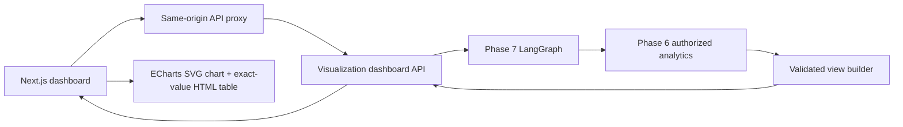

# Phase 8 visualization engine

## Objectives and result

This bounded release converts verified, authorized analytical rows into line, bar, KPI and precise table views. A browser dashboard composes up to eight approved questions. Stacked, scatter and geographic requests fail with a typed error because the current Phase 6 contract does not provide approved multi-series pairs or coordinates. No LLM invents a chart value. A dashboard is recomputed on every refresh, so permissions are rechecked. There is no saved dashboard or share-link capability.



The endpoint calls LangGraph for **each** card; LangGraph calls the existing Phase 6 service with the server-derived identity and expected workspace. The view builder copies decimal strings and checks numeric finiteness, shape, row limit, duplicate labels and one dataset version across cards. It returns a fail-closed 409 if the active version changes mid-request. It may add one deterministic **verified observation** identifying the highest displayed value; hypotheses and recommendations are never generated without separate evidence. Neither the browser nor a model can provide metric values to this endpoint.

## Files and API

- [contracts.py](../../../apps/api/src/insightrag/visualization/contracts.py) defines the request (`workspace_id`, `dataset_id`, one to eight queries), provenance and response. The request contains no value array.
- [routes.py](../../../apps/api/src/insightrag/visualization/routes.py) exposes `POST /api/v1/visualization/dashboard`; it invokes Phase 7 for every card and sets `Cache-Control: private, no-store`.
- [service.py](../../../apps/api/src/insightrag/visualization/service.py) validates data shape and selects `line` for monthly dimensions, `kpi` for a single row, otherwise `bar`. Explicit `table` is supported. Invalid values and unsupported shapes return 422.
- [dashboard-client.tsx](../../../apps/web/src/app/dashboard/dashboard-client.tsx) sends filters and fresh requests. The bearer token stays in component memory, never local storage.
- [chart-card.tsx](../../../apps/web/src/app/dashboard/chart-card.tsx) renders ECharts using SVG, resize observation, tooltip and zoom for longer series. Its HTML table displays original decimal strings; SVG/canvas numeric plotting uses JavaScript numbers and may lose decimal precision, so the table is the exact representation.
- [route.ts](../../../apps/web/src/app/api/dashboard/route.ts) is a same-origin proxy that forwards only bearer and organization headers and disables caching. It does not grant access.
- [visualization.ts](../../../apps/web/src/lib/visualization.ts) mirrors the response type and rejects malformed/non-finite graph data.

Request example (synthetic IDs, replace with real authorized IDs):

```json
{"workspace_id":"00000000-0000-4000-8000-000000000001","dataset_id":"00000000-0000-4000-8000-000000000002","views":[{"question":"Monthly revenue for Delhi in 2025","region":"Delhi","year":2025,"kind":"line"}]}
```

Requires `Authorization: Bearer <OIDC token>` and `X-Organization-ID` headers. The organization header is checked against current server membership; it is not proof of dataset access. A response card includes metric definition, unit, dates, timezone, filters, exact decimal strings, source row counts, source hash and version. HTTP 401/404/409/422/429/503/504 errors carry the existing API error contract; a failed card aborts the dashboard.

## Delhi dashboard demonstration

The browser template asks six separate approved questions for **synthetic or owned governed data**: monthly Delhi signed revenue; Delhi signed revenue KPI; Delhi share of authorized national signed revenue; Delhi **product** breakdown; regional breakdown; and an exact regional table. The first query follows browser → same-origin proxy → LangGraph → Phase 6 SQL → validated view → ECharts + table. The [synthetic Delhi fixture and independently computed results](./delhi-demo.md) provide concrete expected values. They are not a measured API trace or financial benchmark. Real outputs depend on the uploaded dataset and its permissions. The approved SQL is generated by the fixed Phase 6 planner, not supplied by this frontend.

Month-over-month revenue growth cannot be claimed: Phase 6 explicitly rejects that metric. Likewise the sales schema has `product`, not `category`. The dashboard visibly says so instead of labeling product as category or calculating growth in JavaScript. The exact national-share calculation is performed by Phase 6 only when authorized national scope is available. Mixed currencies require an explicit currency filter and are never converted implicitly.

## Run and verify

With the repository's local secret files and OIDC settings configured, run `docker compose up -d --build`, provision an entitled governed sales dataset, then open `http://127.0.0.1:3000/dashboard`. The web proxy defaults to `http://127.0.0.1:8000` for a host-run web process; [compose.yaml](../../../compose.yaml) sets `API_INTERNAL_BASE_URL=http://api:8000` for the Compose web container. Do not put that value or a token in public configuration. A host-run alternative is `npm run dev:web` alongside the existing API.

```powershell
.\.venv\Scripts\python.exe -m pytest apps/api/tests/test_visualization.py -q
.\.venv\Scripts\ruff.exe check apps/api/src/insightrag/visualization apps/api/tests/test_visualization.py
.\.venv\Scripts\mypy.exe apps/api/src/insightrag/visualization
npm run test:web
npm run typecheck:web
npm run lint:web
npm run build:web
```

Test scope and actual outcomes are tracked in [visualization tests](../../testing/visualization-tests.md). The current browser uses a token entry field because enterprise SSO login UX is not implemented yet; it must be replaced before general release. The browser can print the currently authorized cards as a local report or save them as PDF through the operating system; there is no server-side PDF report generation, persisted dashboard, or share link.

## Learning and decisions

Read [architecture](./architecture.md), [walkthrough](./implementation-walkthrough.md), [comparisons](./technology-comparisons.md), [chart selection](../../concepts/chart-selection.md), [specification validation](../../concepts/visualization-specifications.md), [dashboard architecture](../../concepts/dashboard-architecture.md), [security](../../security/visualization-security.md) and [interview preparation](../../interview/phase-08-visualization.md). The next phase depends on SSO browser identity, approved MoM/category metric semantics, stronger end-to-end frontend tests and export authorization policy. These are not silently assumed complete.
