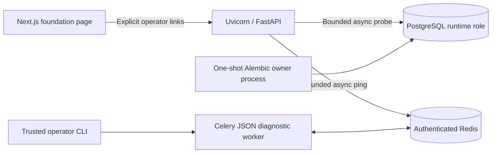

# Phase 2: repository, backend and infrastructure foundation

Status: Implemented foundation, pending owner review and the environment checks listed in [verification](testing/phase-02-verification.md). The owner explicitly authorized Phase 2 using the Phase 1 direction. This does not resolve private-data region, retention or metric-policy questions.

## 1. Objectives and acceptance criteria

Build a modular runnable monorepo, typed/versioned FastAPI, async PostgreSQL connections and migration, secret/configuration handling, bounded health probes, safe logs/errors/request IDs, Redis/Celery diagnostics, local Compose, Next.js/TypeScript, locks and CI. Do not implement RAG, analytics, identity or tenant data endpoints.

Acceptance: clean environment installation from locks; unit/security checks; lint/format/type/build checks; meaningful real-service integration tests; exact execution commands and actual verification record. Docker/real-service/hosted-CI results must not be inferred from source files or unit tests. See the record for gaps.

## 2. Architecture and data flow



The page does not claim live connectivity; it links actual operational endpoints. The worker has no public submission API. No user/tenant table exists yet, preventing a foundation endpoint from accidentally becoming a pre-authentication content API.

## 3. Decisions and alternatives

- Python 3.12 and uv workspace: consistent container/local/CI toolchain; `.python-version` selects the minor, `uv.lock` resolves exact dependencies/hashes. Python/Node runtime images currently use minor/major tags, not immutable digests; full release provenance needs verified base-image digest pinning later.
- FastAPI/Pydantic: explicit async request contracts and generated OpenAPI; Django would suit admin-heavy requirements but is unnecessary here.
- SQLAlchemy async engine plus asyncpg: bounded process-local pooling and request sessions; use synchronous DB code in thread pools only when the driver requires it.
- Alembic as a dedicated process: application startup does not race replicas running DDL. Owner and runtime credentials are separated.
- Celery/Redis: operator-only idempotent ping validates registration/configuration. Durable tenant job/outbox behavior remains a later feature, not a property conferred by Celery.
- No fabricated authentication: diagnostics are development-only; production disables docs/echo, and metadata/health expose no tenant data.
- Strict field-allowlisted JSON logging omits third-party message/exception text. Less detail is accepted to prevent accidental URL/payload/credential disclosure; add safe diagnostic codes deliberately.
- Docker Compose is local development, not production orchestration. No cloud deployment or CD credentials are added.

## 4. Folder and file changes

| Area | Important files | Responsibility |
| --- | --- | --- |
| Workspace | `pyproject.toml`, `uv.lock`, `.python-version` | Python workspace, tool policies, exact transitive resolution |
| Python package | `apps/api/pyproject.toml`, `src/insightrag/` | Installable API/worker package; domain boundaries can grow without transport coupling |
| Application | `main.py`, `api/v1/routes.py`, `api/contracts.py` | Lifespan-owned resources, versioned routes, request/response schemas |
| Cross-cutting | `core/config.py`, `logging.py`, `middleware.py`, `errors.py`, `.env.example` | File/env secrets, safe native config template, redacted JSON, correlation, sanitized failures |
| Database | `db/session.py`, `migrations/`, `alembic.ini` | Pool/session DI; explicit migration and schema state |
| Health | `api/health.py` | No-dependency liveness; timeout-bound DB/Redis/schema readiness |
| Worker | `worker.py` | JSON-only Celery setup and pure diagnostic task |
| Backend tests | `apps/api/tests/` | Contracts, lifecycle, correlation, redaction, settings, worker and real integration |
| Web | `apps/web/`, root `package.json` and `package-lock.json` | Next.js/React/TypeScript/Tailwind, exact npm workspace dependencies |
| Local infra | `compose.yaml`, `infra/`, `scripts/bootstrap-local.mjs` | Scoped secrets, runtime role, health-gated processes, non-root app images |
| CI | `.github/workflows/ci.yml` | Python/web/docs checks, service integration, audits, container smoke |

Detailed code explanations: [backend internals](concepts/phase-02-backend.md), [web foundation](modules/web-foundation.md), [local operations](operations/phase-02-local.md), [CI](operations/phase-02-ci.md).

## 5. Small implementation steps

1. Retain Phase 1 and record explicit Phase 2 authorization.
2. Add Python/npm workspaces and dependency locks.
3. Implement configuration, contracts, application lifespan, correlation and safe errors/logging.
4. Add bounded DB pool, session dependency and migration-only foundation table.
5. Add readiness and operator diagnostic worker; no content routes.
6. Add local secrets/bootstrap, service roles and Compose/container definitions.
7. Add frontend skeleton and CI checks.
8. Verify what can run, record unverified environments, document concepts and stop for review.

## 6. Important code and concepts

[Backend teaching guide](concepts/phase-02-backend.md) covers ASGI, async versus sync, DI, lifespan, pooling, migration internals and error/log boundaries. [Web guide](modules/web-foundation.md) covers every significant frontend/configuration file and dependency. [Operations](operations/phase-02-local.md) explains container DNS, ports, secrets, health and process startup.

## 7. Tests

Default pytest excludes real-service tests by an explicit marker; the verification record reports both the default result and any selected integration tests separately. `test_api.py` checks contracts, no tenant routes, invalid input, concurrency, error redaction, correlation and cleanup. `test_config.py` checks secret-source conflicts and fail-fast config. `test_logging.py` checks vendor/server leak paths. `test_worker.py` validates JSON/eager diagnostic semantics, not broker delivery. `test_integration.py` uses real migrated PostgreSQL/Redis when configured; CI treats missing service configuration as failure.

## 8. Exact local execution

Full setup requires Docker Engine/Desktop with Compose v2, Node.js 24, and uv 0.13.7 for native Python development. From the repository root:

```powershell
node scripts/bootstrap-local.mjs
docker compose config --quiet
docker compose up --build --wait
```

Then open web `http://localhost:3000`, API documentation `http://localhost:8000/docs`, schema `http://localhost:8000/api/v1/openapi.json`, live `http://localhost:8000/health/live`, ready `http://localhost:8000/health/ready`. These are intended local URLs, not a claim services are running now.

Native backend without dependencies (readiness deliberately returns 503):

```powershell
uv python install
uv sync --locked --all-packages
uv run --package insightrag-api uvicorn insightrag.main:app --reload --no-access-log
```

The native no-dependency mode assumes no INSIGHTRAG dependency URL variables are set. To connect native services/worker, follow the exact secret-file environment commands in [local operations](operations/phase-02-local.md). Never run migrations with runtime credentials or leave owner credentials in the API environment.

Frontend:

```powershell
npm ci
npm run dev:web
```

Windows sandbox/cache-specific commands used here are in the verification record; ordinary environments do not need project-local uv caches.

## 9. Expected results and verification commands

```powershell
uv run ruff check .
uv run ruff format --check .
uv run mypy
uv run --package insightrag-api pytest
uv run --package insightrag-api python scripts/smoke-api.py
npm run lint:web
npm run format:check:web
npm run typecheck:web
npm run test:web
npm run build:web
node scripts/validate-phase1.mjs
node --test scripts/*.test.mjs
```

Live returns `{"status":"ok"}` even if DB/Redis are down. Ready returns 200 only with reachable dependencies AND the expected schema/revision; otherwise 503 with safe status labels. Echo accepts `{"message":"synthetic"}` only in development/test. Invalid input returns 422 with code, request_id and issue types, without rejected values. Every API response carries X-Request-ID. Production hides OpenAPI/echo; export the schema in a safe build/test environment for documentation.

Audits and integration commands are in [CI guide](operations/phase-02-ci.md). Runtime vulnerability queries require network access. Passing local tests is not a substitute for those checks.

## 10. Limitations and failure scenarios

No SSO/RLS/tenant data/RAG/analytics/outbox yet. Celery diagnostic registration is not durable business-job infrastructure. Compose credentials are local-only; production needs an approved secret service, TLS/network policy and region. No object storage is provisioned because this phase has no upload feature. Docker and hosted CI may be unverified locally; consult actual results. Existing PostgreSQL volumes retain initial passwords; bootstrap must not silently rotate only files. Wrong schema or dependency outage keeps readiness false without killing the live process.

## 11. Performance and scalability

Each API process owns at most pool_size + overflow DB connections (default 10), plus other service/migration connections; budget across replicas before changing worker count. Never share AsyncSession across concurrent tasks or hold transactions while waiting for model calls. Readiness probes run dependencies concurrently with deadlines; process saturation still needs real load testing. Worker concurrency is bounded; long CPU parsing will need separate pools later. No throughput benchmark is claimed.

## 12. Interview questions and answers

Read [Phase 2 interview exercises](interview/phase-02.md), [web exercises](modules/web-foundation.md) and CI/local teaching guides. Each backend learning domain includes system-design and debugging examples.

## 13. Documentation updates

New Phase 2 guide, teaching, runbooks, verification and interview files explain actual implementation. Phase 1 remains a historical design record. Its validator skips dependency/build directories now; it still checks the original coverage contract. The learning journal and project instructions point to the active phase.

Pre-review housekeeping preserves these source/document boundaries, removes reviewed caches/scratch outputs, and hides generated local state in VS Code. See the [repository layout guide](operations/repository-layout.md), [Windows Docker setup](operations/docker-windows.md), and the updated [verification record](testing/phase-02-verification.md). The owner has now installed Docker and engine checks passed; follow-up runtime results are recorded in verification. This cleanup does not authorize the next phase.

## 14. Next phase dependencies and review stop

Review the actual results and limitations. Phase 3 adds verified identity, memberships, transaction-local tenant context, resource policies/RLS, security migrations and adversarial access tests before any tenant-content route. Region/retention/metric questions remain private-data admission gates. Do not automatically start Phase 3.

Understanding check: Why can liveness pass while readiness fails? Why must a request not share AsyncSession with another concurrent request? Why are migrations a separate process with different credentials?
