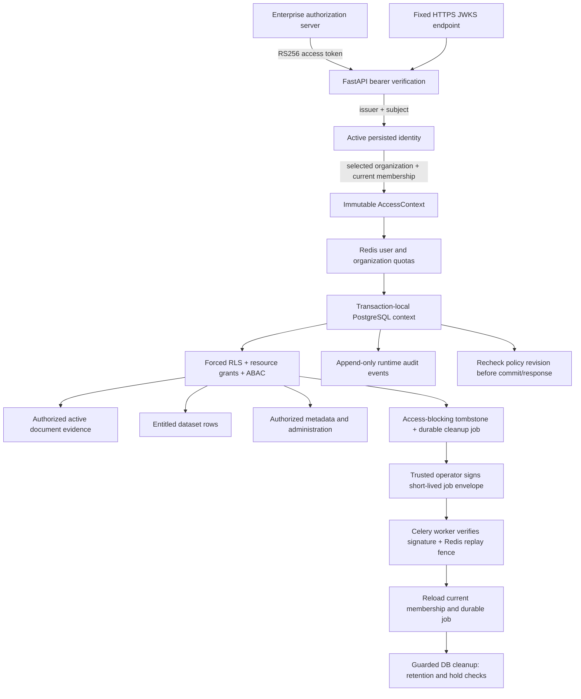

# Phase 3: enterprise security and tenant isolation

Status: implemented security foundation, pending owner review and the deployment controls documented below. The owner explicitly authorized this phase in chat. Phase 4 ingestion, model orchestration, production SSO onboarding and cloud deployment are separate work. Implemented controls are not a compliance certification.

## 1. Objectives and acceptance criteria

Establish verified enterprise identity, current database authorization, tenant-scoped persistence, protected API boundaries and safe asynchronous identity. Company A must not read, change, aggregate, infer existence of, or execute work on Company B's protected resources. Membership, grants, classification, MFA, purpose and row entitlements must be checked server-side. Missing identity, database, quota or scanner controls fail closed.

Acceptance requires real PostgreSQL tests as the restricted runtime role, real RSA-signed access-token API tests, Redis quota/replay checks, explicit deletion/retention behavior, actual check results and documented cloud gaps. A mocked tenant filter or successful migration alone does not establish isolation.

## 2. Architecture and data flow

The API checks identity; PostgreSQL independently constrains accessible rows. This protects against an accidentally omitted organization predicate in trusted application SQL. It does not protect against arbitrary SQL execution under a stolen shared service credential: that role can set application context. Do not expose SQL execution or give the credential to tenants. The narrowly scoped policy-reader role is NOLOGIN, SELECT-only and unavailable through runtime role membership.

Chart generation later must carry this same context, authorize every source, calculate from entitled rows, and store source IDs, versions and policy revision on the derived artifact. Reauthorize both dashboard access and each source on download. There is no chart generation or source-download endpoint in this phase; their absence prevents an unguarded alternate path.

## 3. Decisions and alternatives

| Decision | Reason and accepted tradeoff | Alternative and change trigger |
| --- | --- | --- |
| Fixed issuer/audience/JWKS, RS256 access tokens | Bounded trust configuration; no token-directed discovery or symmetric-key confusion | Add an explicitly registered per-organization issuer registry when multiple IdPs are required; never arbitrary user URLs |
| Operator-provisioned identity and membership | No just-in-time role escalation or incomplete signup workflow | SCIM/invitation administration after lifecycle, ownership transfer and audit requirements are approved |
| RBAC + explicit resource ACL + ABAC | Roles grant capabilities, ACLs grant resource access, attributes narrow access | A policy service when cross-service policy complexity and measured duplication justify it |
| Shared PostgreSQL with forced RLS | Transactional permission/content checks and low initial operational cost | Dedicated tenant database for contractual isolation, residency or noisy-neighbor evidence |
| Policy revisions with transaction checks | Revocation invalidates queued work and blocks stale response release | Fine-grained resource revisions if organization-wide invalidations or lock contention become material |
| Signed short-lived job identities | Queue payload changes cannot mint privileges; DB remains authoritative | Workload identity with a managed queue when deploying cloud workers |
| Conservative quarantine validation | No active publication until future safe ingestion implementation | Sandboxed parsers/CDR and object storage lifecycle in Phase 4 |
| Envelope encryption adapter | Real AES-GCM and tenant/resource binding with an injected managed-key interface | Cloud KMS adapter and IAM after target cloud/region approval |

See the [Phase 3 ADR](architecture/decisions/012-security-foundation.md). Earlier proposed ADRs remain proposed; implementation authorization does not silently approve every architecture proposal.

## 4. File and folder changes

| Area | Important files | Responsibility |
| --- | --- | --- |
| Identity | [auth.py](../apps/api/src/insightrag/security/auth.py) | Verify tokens, bound JWKS cache/fetch, derive fresh MFA |
| Policy context | [context.py](../apps/api/src/insightrag/security/context.py), [database.py](../apps/api/src/insightrag/security/database.py), [dependencies.py](../apps/api/src/insightrag/security/dependencies.py) | Immutable context, transaction-local settings, current membership, quotas, audit and revision fencing |
| Persistence | [schema.py](../apps/api/src/insightrag/security/schema.py), [0002 migration](../apps/api/migrations/versions/0002_tenant_security.py) | Fourteen security tables, composite tenant keys, restricted privileges, RLS helpers, revision/retention triggers, bounded purge function |
| API | [routes.py](../apps/api/src/insightrag/security/routes.py) | Scoped identity, workspace/directory, private resource/grant lifecycle, protected evidence/rows, uploads and audit |
| Async identity | [jobs.py](../apps/api/src/insightrag/security/jobs.py), [worker.py](../apps/api/src/insightrag/worker.py) | Signed operator dispatch, current policy reload, guarded cleanup, JSON-only task registration |
| Controls | [controls.py](../apps/api/src/insightrag/security/controls.py), [uploads.py](../apps/api/src/insightrag/security/uploads.py), [crypto.py](../apps/api/src/insightrag/security/crypto.py) | Scoped keys, Redis limits/replay, file/scanner validation, authenticated envelope encryption |
| Request budget | [body_limits.py](../apps/api/src/insightrag/core/body_limits.py) | 16 KiB body cap before control-plane parsing, actual chunk accounting and exact upload-route exemption |
| Operations | [provision.py](../apps/api/src/insightrag/security/provision.py), [bootstrap script](../scripts/bootstrap-local.mjs), [Compose](../compose.yaml), [configuration](../apps/api/src/insightrag/core/config.py) | Separate privileged provisioning, preserved random secrets, service settings |
| Verification | [tests](../apps/api/tests/), [OpenAPI](api/openapi.json) | Unit, HTTP, real database/Redis, lifecycle and adversarial regressions; generated development contract |

## 5. Small implementation steps

1. Preserve the Phase 2 application and add a new migration; no schema DDL in API startup.
2. Add strict authentication and isolated control adapters with unit tests.
3. Build the tenant schema, RLS helpers and explicit grants as migration-owner work.
4. Propagate verified identity into current database membership, quotas and transaction-local context.
5. Expose bounded protected routes; retain quarantine and prevent runtime publication bypass.
6. Add tombstoning, durable jobs, retention/holds and operator dispatch with fresh worker authorization.
7. Run independent security review and real-service regressions; correct findings before phase review.
8. Document exact setup, teaching, actual evidence and cloud requirements; stop for owner review.

## 6. Important code and concepts

Read the [implementation and concepts guide](concepts/phase-03-security.md) for WHAT/WHY/HOW, key parameters, non-obvious SQL, input/output/error examples, production considerations and improvements. [OIDC integration](security/oidc-integration.md) explains the exact supported token profile. [Controls and cloud requirements](security/controls-and-cloud.md) explains uploads, encryption, cache/queue namespaces and their limits.

## 7. Unit, integration and security tests

Authentication tests use generated RSA keys, malformed JWTs and controlled JWKS transports. Control tests cover tenant-bound encryption, namespaces, replay, quota concurrency and malicious file structures. HTTP tests exercise all protected route authentication gates. Real-service tests use independent synthetic organizations, restricted runtime sessions, actual pgvector/full-text queries, exact row-filtered SQL, cross-tenant mutations, privilege introspection, retention and deletion behavior. API integration verifies signed tokens against the real verifier and DB/Redis.

See [verification](testing/phase-03-verification.md) for executed counts, commands and gaps. Testing a three-dimensional synthetic vector establishes policy behavior; it is not a production embedding schema or retrieval benchmark.

## 8. Local execution instructions

Follow the [security operations runbook](operations/phase-03-security.md). Generate local secrets without changing existing passwords, install from the lock, apply migrations with the separate owner credential, provision an identity from your real authorization server, and use its access token. No local login bypass or fabricated production integration is provided. Without SSO configuration, public health still works and protected data requests fail closed.

## 9. Expected results and verification commands

Run Ruff, formatting, mypy, default pytest, the explicitly selected integration suite, OpenAPI export, smoke script, documentation and bootstrap checks. Exact commands and observed results are in [verification](testing/phase-03-verification.md).

Expected API semantics: no bearer token -> 401 with challenge; unavailable identity/quota service -> 503; inaccessible resource -> uniform 404; a mid-request policy change -> 409; quota -> 429 with Retry-After; control-plane body cap or declared upload size excess -> 413; streamed file-validation size limit -> 422 file_size_limit; untrusted/invalid file -> rejection; unavailable malware scanner -> 503. Validation uploads return stored:false and published:false. Deletion returns state:access_blocked and a cleanup job, never a false assertion that storage/backups have been erased. Other database failures use the centralized safe error path and release no data.

## 10. Known limitations and failure scenarios

- No real IdP account, client registration or browser PKCE/BFF login was configured. The backend accepts only its documented strict access-token profile; some IdPs require a claim mapping or explicit vetted adapter.
- Local Compose uses development transport and volumes. Production requires TLS termination with trusted proxy configuration, database/Redis TLS, encrypted disks/backups, managed secrets and cloud IAM.
- A managed key-provider interface and real authenticated encryption exist; no cloud KMS integration, key rotation service or cloud object store is claimed.
- ClamAV protocol integration exists and fails closed by default. A live antivirus service, fresh signatures, parser sandboxing and content disarm are deployment/ingestion dependencies.
- Object keys are tenant/workspace scoped. Blob deletion remains pending when no storage adapter is installed. Database cleanup retains tombstones/audit and honors holds and retention; backup erasure follows separately approved expiry controls.
- No generated SQL, Python execution, LLM tool loop, chart engine, real document parser or automatic publication is implemented.
- Audit is append-only to the runtime role, not immutable against database operators. Export to independently controlled retention storage/SIEM is required. Revoked memberships may prevent a denial audit insert; sanitized operational HTTP outcomes still record the failure, and cloud collection must cover pre-authentication failures.
- No user-provided purpose or MFA flag is trusted. Asynchronous cleanup uses no fresh MFA delegation and denies MFA-protected work rather than impersonating an interactive session.
- Shared-role RLS assumes a trusted application tier and no arbitrary SQL capability. Database owner and operator credentials remain privileged. Managed PostgreSQL must support a separately controlled helper bootstrap; the local migration owner is intentionally privileged.

## 11. Performance and scalability

JWT verification caches only bounded public JWKS, not stale authorization. Every protected request consults current membership, Redis and PostgreSQL. Quotas use Redis server time and atomic Lua. Application transactions use pooled connections and local settings; context disappears at transaction end. Permission helpers use composite keys and ACL indexes; measure query plans and p95 permission cost with representative ACL sizes before scaling assumptions.

Organization policy locks serialize mutations and prevent revocation races. They also create a potential hot organization bottleneck; monitor lock wait, deadlocks, 409 retries, pool exhaustion, quota latency, JWKS failures, scanner latency and job age. File validation currently buffers up to 50 MiB: enforce connection/concurrency budgets at the edge, then move bounded quarantine streaming to storage in Phase 4. No load benchmark is claimed.

## 12. Interview questions and answers

The [interview guide](interview/phase-03.md) contains identity, RBAC/ABAC/RLS, API transactions, asynchronous jobs, untrusted uploads, encryption and operations questions, including design and debugging scenarios and how to defend these choices.

## 13. Documentation updates

This guide links [architecture/security ADR](architecture/decisions/012-security-foundation.md), [teaching](concepts/phase-03-security.md), [operations](operations/phase-03-security.md), [verification](testing/phase-03-verification.md), [API boundaries](api/phase-03-security.md), [OIDC](security/oidc-integration.md), [cloud controls](security/controls-and-cloud.md), [threat model](security/phase-03-threat-model.md), [interview preparation](interview/phase-03.md) and [learning journal](learning-journal.md).

## 14. Next-phase dependencies

Owner review is required before Phase 4. Resolve actual IdP/client/issuer configuration, region and retention policies, operator ownership, cloud secret/KMS/storage targets and resource publication rules. Ingestion must preserve source/version locators, quarantine until scanning and parsing succeed, use idempotency and version fencing, enforce permissions before indexing, and recheck authorization at every retrieval/analytics/artifact boundary. Uploading parses and indexes data; it does not train the model.
