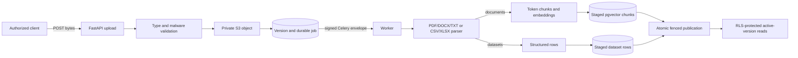

# Phase 4 — bounded, version-aware ingestion

**Status:** implemented for review; cloud integration and production hardening are unverified. This phase does not implement Phase 5 retrieval or Phase 6 analytical SQL. Uploading a file parses and indexes authorized data; it does not train or fine-tune an LLM.

## Objectives and acceptance

An authenticated uploader with workspace and resource `upload` capability can submit a supported file. The service validates a 50 MiB bounded body, requires a clean malware verdict, stores server-generated version keys in a private SSE-KMS bucket, reserves an idempotent durable job, and dispatches Celery after the request transaction. `X-Reindex: true` explicitly creates a fresh version from unchanged, rescanned bytes. A worker rechecks current membership, grants, classification and policy revision; it verifies the stored SHA-256, parses, chunks or preserves dataset rows, and publishes only if the version is still latest. Published reads pass RLS and use the active version. Deleted resources disappear from reads immediately; deletion workers clear object versions before DB cleanup. These are code behaviors, not claims that a particular cloud bucket, scanner or provider was verified here.

The acceptance evidence is [ingestion tests](testing/ingestion-tests.md). Phase 3 tests continue to guard identity and isolation. Explicitly deferred: >50 MiB multipart uploads, OCR accuracy evaluation, per-tenant queue fairness, typed metrics and SQL analytics, actual vector retrieval/reranking, cloud KMS/S3 exercise, production malware service exercise, and a fully separated worker DB credential. Do not call this production certified.

## End-to-end path

The route and parser use bounded memory for a maximum 50 MiB source, but parsed/expanded content can still exceed that size. A separate sandboxed parsing process and memory quota are required for hostile production workloads. Job staging and publication share one transaction; no partial chunk set is visible. Repeated deliveries can run more than once, so the active version and deterministic primary keys are the idempotency boundary. See [architecture](modules/ingestion/architecture.md), [walkthrough](modules/ingestion/implementation-walkthrough.md), and [security](security/ingestion-security.md).

## Decisions and next dependencies

The [Phase 4 ADR](architecture/decisions/013-versioned-ingestion.md) remains proposed until owner review. It selects PostgreSQL/pgvector rather than an additional vector service, REST upload plus progress polling rather than a persistent socket, and a separate dataset row path rather than embedding numeric records as evidence. The Phase 5 dependency is active-version retrieval that enforces exactly the same ACL/RLS boundary and cites real stored locators. Phase 6 must define numeric column types, units, dates, time zones and approved analytical queries before reporting totals.

Three review questions appear at the end of [the interview guide](interview/phase-04-ingestion.md).
