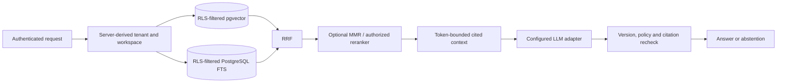

# Phase 5 — permission-aware document RAG

**Status:** implemented for review. This is a bounded document RAG milestone, not a production certification. It depends on the Phase 4 published-chunk schema and Phase 3 server-derived identity. Phase 6 deterministic analytics is not implemented here. Uploading data indexes it; it never trains the language model.

## Objectives and acceptance

An authenticated member can ask a document question within a workspace, optionally narrowing to document IDs. PostgreSQL evaluates current ACLs and active versions in the dense and lexical retrieval queries. RRF merges candidates, optional MMR diversifies them, and an optional external reranker sees only authorized candidates. A token-bounded context is sent to an explicitly configured generation provider. The response contains verified chunk identifiers, real version and locator metadata, or abstains. A second database transaction checks evidence and policy after inference. Conversation turns remain owner/workspace scoped through RLS. Exact aggregate questions return `analytics_required` until the authorized structured analytics phase exists.

Acceptance evidence is in [retrieval evaluation](testing/retrieval-evaluation.md). The reference implementation does **not** prove every claim semantically supported merely because its citation ID is real. That requires labelled evaluation and human review. Local cross-encoder serving, calibrated thresholds, LLM query rewriting, streaming, full provider benchmarking, and production load results are deferred. These decisions are reviewable in [ADR 014](architecture/decisions/014-hybrid-grounded-retrieval.md).

## Key decisions

The selected sparse rank is PostgreSQL `ts_rank_cd`, **not BM25**. Rank fusion avoids pretending lexical and cosine scores have comparable scales. Cosine distance is filtered only when an operator supplies a calibrated threshold; the default is no numeric cutoff. The query route uses REST because a bounded non-streamed answer has ordinary request/response semantics. Streaming via SSE is deferred until client needs and disconnect behavior are measured. Evidence and conversation storage inherit tenant RLS. External model endpoints require HTTPS. No answer cache is introduced while permission and version invalidation remain unsettled.

## Review questions

1. Why must the SQL candidate query filter ACLs before text reaches fusion or reranking?
2. Why does a real chunk ID alone fail to prove that a generated claim is faithful?
3. Why is the same cosine-distance threshold unsafe across changed embedding models?

Stop here for owner review before Phase 6.
