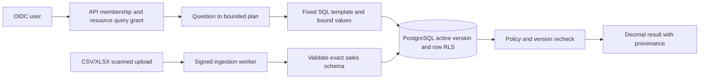

# Phase 6 — governed structured analytics

**Status: implemented for review, with production gaps listed below.** The owner explicitly authorized this phase after Phase 5. This phase does not begin chart/dashboard work. Uploading parses and indexes authorized data; it does not train a model.

The owner authorized remediation of the [independent review](modules/analytics/PHASE_06_REVIEW_REPORT.md). Gross/net and MoM requests now fail closed; XLSX midnight dates, SQL-reference checks and provenance have additional tests. Full enterprise BI remains NO-GO pending approved financial/FX/join contracts and representative load verification.

## Objectives and acceptance

An authorized dataset upload with the exact sales contract becomes a typed, versioned PostgreSQL projection. A caller can discover the authorized catalog and ask a bounded revenue/profit/margin/units/returns question. The server resolves an explicit calendar period and compiles a typed plan to fixed, parameterized SQL. PostgreSQL row security restricts each row. Results contain decimal strings, metric semantics, units, timezone, period, filters, version and source-row counts. National contribution requires complete region entitlement. The [test report](testing/analytics-tests.md) separates executed checks from unavailable real-service tests.

## Decisions and boundaries

The supported business model is one transaction-grain sales table, not an inferred arbitrary spreadsheet warehouse. Signed revenue includes refunds; profit is signed revenue less signed cost; margin is the ratio of aggregate profit to aggregate revenue. Currency conversion, cross-dataset joins, arbitrary text-to-SQL, source-database connectors, and LLM explanation are deferred because their policy and metric contracts are not defined. The API does not send figures to an LLM. A narrow rule-based question compiler avoids untrusted SQL and can request clarification. PostgreSQL is the governed execution path; DuckDB is an offline in-memory comparison adapter, not an authorized service execution path. [ADR 015](architecture/decisions/015-governed-sales-analytics.md) is proposed, awaiting owner review.

## Review assumptions and risks

- The sales file has exactly nine named columns and one row per unique `transaction_id` within one version. Currency is a three-letter uppercase code. The date is an already interpreted business-local calendar date, not a UTC timestamp.
- Negative revenue/cost represent signed adjustments; `returns` counts returned units. Source owners must approve these definitions before real financial reporting.
- The organization reporting timezone defaults to UTC until a controlled administrator changes `orgs.reporting_timezone`. The API has no timezone administration endpoint yet.
- A previous-three-month result excludes the current partial month. Year comparisons use explicit whole calendar years; absent, zero or negative baselines produce null growth pending an approved interpretation.
- Rows outside a caller's region entitlement are excluded, including from schema discovery. National share is denied if any active row is outside that entitlement.
- Cross-region totals are *authorized-scope totals* unless the complete-scope check is used. They must not be labelled national by a client.

## Next dependencies

The isolated Phase 3 PostgreSQL/Redis stack passed migrations through `0008_analytics_scope` and 62 real-service integration tests; see the [test report](testing/analytics-tests.md). A restricted-role SQL oracle and one measured 10,000-row synthetic case now exist. Before real deployment: approved sales glossary and currency policy, controlled timezone management, documented row-entitlement administration, provider/connector threat review, concurrency/load tests, and an authorized snapshot worker before DuckDB can process production data. See the [module guide](modules/analytics/README.md) and [security design](security/analytics-security.md). Stop here for Phase 6 review.

## Three understanding questions

1. Why can an authorized SQL `SUM` still produce the wrong *national* denominator for a regional analyst?
2. Why is `SUM(revenue-cost)/SUM(revenue)` the correct aggregate margin here, rather than averaging each row's margin?
3. Which checks prevent a stale dataset version or revoked grant from appearing in an analytics response?
