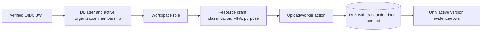

# Phase 4 ingestion security invariants

Authentication establishes who sent a request; it does not grant document access. A valid JWT plus an organization header only selects a candidate organization. [Identity resolution](../../apps/api/src/insightrag/security/dependencies.py), [resource authorization](../../apps/api/src/insightrag/security/database.py) and PostgreSQL RLS must all succeed. The API checks workspace role, resource grant, classification, MFA, purpose and active membership before upload. Progress is scoped to the job requester plus current upload capability. Published evidence/rows require current `read`/`query` rights and the active version. Region entitlements filter structured rows. A pooled DB connection uses transaction-local `set_config` and resets when the transaction ends; no session-level tenant variable is trusted.

The [validator](../../apps/api/src/insightrag/security/uploads.py) rejects unsupported types, path-like filenames, PDF active/encrypted markers, archive traversal/nesting/expansion, binary text and oversize bodies, then requires a clean scanner verdict. It is a defense-in-depth filter, not proof that a parser cannot be exploited. Source keys are generated from UUID organization/workspace/resource/version values by [object_key](../../apps/api/src/insightrag/security/controls.py), never from filenames or model text. The [S3 adapter](../../apps/api/src/insightrag/ingestion/storage.py) requires HTTPS custom endpoints and SSE-KMS writes. IAM, bucket policy, private networking, TLS verification, bucket versioning/replication, KMS permissions and regional residency must be configured in deployment. No bucket or cloud key was created here.

Workers receive HMAC-signed, expiring, Redis single-use envelopes, but signatures are not permissions. [The worker](../../apps/api/src/insightrag/ingestion/service.py) loads current DB membership and policy revision, requires the stored actor/job/resource match, checks the object key namespace and SHA-256, and reauthorizes before publication. `latest_version` and policy revision fence out stale workers. Document text is untrusted data: it is parsed and embedded, never executed as code or treated as instructions. No generated SQL/Python path is introduced. Invalid model vector size/NaN/zero is rejected. PostgreSQL runtime grants and forced RLS protect stage/reads; SECURITY DEFINER functions perform narrow reservation/publication and deletion transitions.

Deletion first tombstones a resource, immediately denying normal reads. [Migration 0004](../../apps/api/migrations/versions/0004_ingestion_deletion.py) prevents a security job from claiming completion while versioned storage exists. The signed [deletion worker](../../apps/api/src/insightrag/security/jobs.py) checks legal hold/retention, enumerates authorized version keys, deletes S3 objects, then removes stage rows, versions and legacy rows in one DB transaction. If storage deletion fails, the DB remains pending; repeated S3 delete is idempotent. Backups, object-store replicas and provider retention are governed outside this code and may persist after logical deletion. A compromised runtime credential can invoke narrow SECURITY DEFINER functions, including a deletion-completion attestation; separate worker credentials and external object-erasure verification are production hardening requirements.

**Threats and remaining controls:** prompt injection in a document must remain untrusted during Phase 5 answer generation; vector similarity must never bypass current ACL; provider calls may export private text and need contractual residency/DPA review; OCR/parser vulnerabilities need a no-network sandbox with CPU/RAM/temp-disk limits; object/orphan reconciliation must inspect failed pre-reservation writes; upload quotas need per-tenant byte/day and concurrency limits beyond current request rate limiting; signed jobs need key rotation; audit logs need protected retention. The [integration test](../../apps/api/tests/test_rls_integration.py) demonstrates A's published chunks are invisible to B on the runtime role, but it does not prove a live cloud IAM policy or compliance certification.
