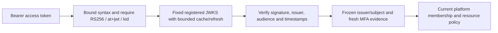

# OIDC identity and OAuth access-token integration

Phase 3 resource-server module. No live identity-provider account, enterprise federation, login UI, callback, refresh-token store or SSO deployment is configured by this code. Tests generate real RSA signing keys locally and use HTTPX mock transport for provider behavior.

## WHAT and WHY

OIDC establishes a user's identity during login. OAuth access tokens authorize a client to call an intended API. An OIDC ID token is for its client; accepting it as an API access token risks token substitution. This verifier therefore accepts a deliberately constrained signed access-token profile: `RS256`, JOSE `typ` exactly `at+jwt`, and the configured API audience. The profile follows the access-token distinction in [RFC 9068](https://www.rfc-editor.org/rfc/rfc9068.html), while the complete issuer contract must still be validated before enabling a real provider. This module does not claim to implement every optional or required feature of the whole RFC.

The trusted identity is the exact `(issuer, subject)` pair. Email, display name, token tenant claims, groups and roles do not create platform membership or content access. Current application/database authorization decides those separately. A verified signature alone is not tenant authorization.

PyJWT with its cryptography dependency provides signature and registered-claim verification. HTTPX provides nonblocking bounded retrieval of a fixed operator-configured JWKS endpoint. A provider SDK is a viable alternative when provider-specific protocols are required; deriving discovery/key URLs from an incoming token is rejected because it lets attackers choose authentication dependencies.

## HOW



The operator registers issuer, audience and JWKS URL. Issuer matching is literal: changing a trailing slash or path changes the identity namespace. Both registered URLs require HTTPS without credentials, query or fragment in this implementation, including local test configuration. An unconfigured/insecure provider fails closed as unavailable; it never selects an issuer from the token.

Before network activity, the verifier limits the token to 8,192 ASCII bytes, requires three base64url segments, rejects duplicate JSON members/nonfinite JSON values, and requires an opaque printable key ID of at most 128 characters. It rejects unsupported JOSE `jku`, `x5u`, embedded `jwk`/`x5c`, `crit` and `b64` headers; these cannot alter key retrieval or verification. The algorithm allowlist is fixed independently of untrusted headers, as required by the [PyJWT security guidance](https://pyjwt.readthedocs.io/en/stable/api.html).

Only public RSA signing keys of 2,048–4,096 bits are used. The parser rejects private material, ambiguous duplicate key IDs, invalid modulus/exponent data, oversized key sets and sets without a usable verification key. JWKS is limited to 20 entries and 128 KiB. HTTPS response redirects and compressed responses are rejected; `Accept-Encoding: identity` avoids decompression amplification. Requests include no bearer token.

The owned client uses `trust_env=False`, certificate verification, no redirect following, a small connection pool and two-second operation timeouts. A separate `asyncio.timeout` bounds total request/lock time because HTTPX read timeouts apply to inactivity per chunk, not an entire slow response. See [HTTPX timeouts](https://www.python-httpx.org/advanced/timeouts/). A caller-injected client remains caller-owned and must explicitly disable environment trust; do not inject an insecure production transport.

## IMPLEMENTATION and interfaces

`apps/api/src/insightrag/security/auth.py` owns:

- `Principal`, a frozen/slotted dataclass with `issuer: str`, `subject: str`, `authenticated_at: int` and `mfa: bool`. It deliberately has no tenant/role fields.
- `AuthenticationError`, the invalid-credential result to map to HTTP 401 with a safe bearer challenge.
- `AuthenticationUnavailable`, the unconfigured/unreachable/invalid-provider result to map to HTTP 503. A provider outage is not evidence that a user supplied a valid or invalid identity.
- `OIDCVerifier(issuer, audience, jwks_url, *, jwks=None, client=None, clock_skew_seconds=30)`. A supplied JWKS is an explicitly pinned offline/test source; it does not perform automatic network rotation.
- `await verify(token) -> Principal`, which validates and returns identity or a safe exception. The application owns subsequent user/membership lookup; no JIT organization enrollment occurs here.
- `await close()`, which closes an owned client, clears keys and makes later verification unavailable. It does not close a caller-owned client.

Private helpers separate unique-member JSON parsing, registered URL validation, bounded JOSE syntax, public-key conversion and verified-claim checks. Neither parsed unverified claims nor a fetched key by itself can produce a Principal. PyJWT always verifies with the fixed `RS256` allowlist, then explicit application checks enforce the narrower profile.

Required claims are `iss`, `sub`, `aud`, `exp`, `iat` and `nbf`. `exp`/`iat`/`nbf` must be actual nonnegative integers, not booleans, floats or numeric strings. Maximum token lifetime is 3,600 seconds from `iat` to `exp`; the interval must be positive. The issuer is checked again exactly; audience may be a string or a bounded list including the intended API. Subject is nonempty, bounded to 255 characters and excludes control characters. Clock skew defaults to 30 seconds and cannot exceed 60.

## MFA and authentication time

`mfa=True` requires verified `amr` containing `mfa` and a valid integer `auth_time` no more than 300 seconds old. A present malformed/future authentication time invalidates the token. Missing or old `auth_time` leaves the identity authenticated but sets `mfa=False`, so an MFA-required operation must deny it. `authenticated_at` uses verified `auth_time` when present; for non-MFA tokens without it, the field falls back to issuance time and must not be treated as proof of recent interactive authentication.

Example: an access token issued now with `amr=["mfa"]` but `auth_time` one hour ago does not prove fresh MFA. Refreshing a token changes `iat`, not the original authentication event. The module tests the 300/301-second boundary explicitly. The provider integration must confirm that its `amr`/`auth_time` semantics really represent the desired interactive MFA; this module cannot infer that from generic token syntax.

## Cache, rotation and failure behavior

Valid fetched keys cache for 300 seconds. A new key ID can trigger refresh, but **all** refresh attempts share a five-second per-verifier throttle, including negative/unknown key IDs and provider failures. An async lock coalesces concurrent misses. A cache entry is never used past TTL after provider failure. A fresh known key can continue working during an unsuccessful unknown-key refresh; it remains within the stated cache lifetime.

Valid JWKS without the requested key yields invalid token/401. Failed or malformed JWKS yields unavailable/503 and refresh backoff. During the five-second throttle, a newly introduced key can temporarily be denied; providers should publish rotation keys before issuing tokens with them. The throttle/cache are process-local, so total JWKS traffic scales with replica/process count; network admission and provider monitoring remain operational requirements.

Signing-key revocation can take up to the cache lifetime to propagate. Emergency cache reset/restart and current database user/membership disablement need an operational procedure. Stateless verification does not implement token introspection, individual JWT revocation, session logout or a distributed session denylist.

## SSO edge integration points

A later web/session boundary should use authorization code flow with PKCE, validated state/nonce, exact registered callback URLs and secure HTTP-only cookies. Keep refresh tokens and provider client secrets off the browser and out of logs; add CSRF defenses to cookie-authenticated mutations. Obtain an API-audience access token and call the resource server using that token, not the ID token. Register enterprise issuers only through approved operator/admin configuration, not a browser-supplied discovery URL.

No callback, hosted IdP, SAML gateway or account provisioning is invented here. Before enabling an issuer, verify TLS/DNS/egress, audience/claim contracts, MFA semantics, key rotation, retention/residency and deprovisioning behavior against that provider. The existing public foundation endpoints do not become evidence of configured SSO.

## Tests and exact commands

`apps/api/tests/test_auth.py` generates real RSA keys/tokens and covers signature/algorithm/type/issuer/audience/required claims, timestamp types/lifetime, fresh MFA, tenant-role claim ignorance, malformed/oversized credentials, key rotation, unknown-key floods, cache expiry, provider failures, redirects, compression, response limits, private/weak/duplicate keys, HTTPS configuration and client ownership.

From the repository root after installing the locked Python environment:

```powershell
uv run --package insightrag-api pytest apps/api/tests/test_auth.py
uv run ruff check apps/api/src/insightrag/security/auth.py apps/api/tests/test_auth.py
uv run mypy
```

Actual targeted verification on 2026-11-16: **84 auth tests passed** with PyJWT 2.15.1 and cryptography 48.0.1; Ruff checks, Ruff formatting and strict mypy for `auth.py` passed. The only pytest warning came from the existing Starlette/httpx TestClient compatibility path in the shared test fixture. The first collection attempt preceded dependency synchronization and failed because `jwt` was absent; the post-sync run passed. Complete phase/integration results belong in the Phase 3 verification record. These generated-key/mock-transport tests do not prove interoperability with a live enterprise issuer or complete tenant isolation.

## PRODUCTION and IMPROVEMENT

Monitor safe authentication outcome codes, verification latency, cache age, refresh count/failures, token-rate limits and issuer availability. Never record bearer tokens, payloads, raw provider errors or JWKS bodies in request logs. RSA verification is bounded but consumes CPU; measure saturation and apply request admission before considering offloading. Additional algorithms, opaque-token introspection, multi-issuer routing or distributed cache need explicit new contracts and tests.

## INTERVIEW

1. **System design: where does SSO end and tenant authorization begin?** The issuer establishes `(iss, sub)` through a verified API access token. Current platform membership/resource rules decide tenant access independently; external role claims do not bypass them.
2. **Debugging: why does a newly rotated token get 401 for several seconds?** A shared five-second refresh throttle protects JWKS from arbitrary unknown-key floods. Publish keys before issuing them, inspect safe cache/refresh metrics, and confirm exact key ID/provider profile.
3. **Why not choose the verification algorithm from `alg`?** The attacker controls that header before verification. A fixed asymmetric allowlist avoids unsigned/symmetric/asymmetric confusion; a library cannot choose the application's trust policy.
4. **Why is a new `iat` insufficient for fresh MFA?** It records token issuance and may change during refresh without a new authentication event. Verified `auth_time` and provider-defined `amr` are required for recent MFA proof.
5. **Why does a cached key not eliminate provider-outage policy?** Caches delay revocation. Use only fresh keys within the stated TTL, fail closed beyond it, and distinguish provider-unavailable from malformed credentials so operators can diagnose the actual dependency failure.
